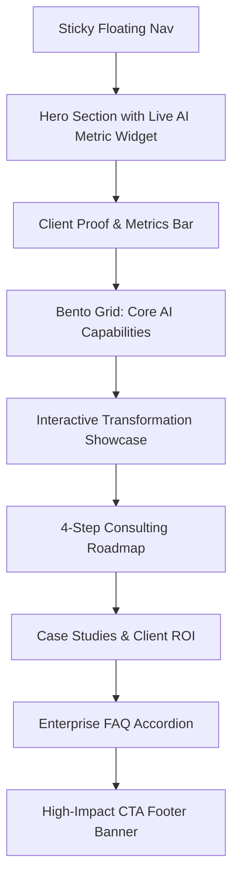

# VisioAI — AI Consulting Landing Page Design & Implementation Guide

This skill provides the design system, structural architecture, copy guidelines, and implementation patterns for creating enterprise-grade AI consulting landing pages modeled after the **VisioAI** concept (originally designed by Adhiari Subekti for One Week Wonders on Dribbble).

---

## 1. Design Philosophy & Visual Language

The VisioAI aesthetic is engineered to convey **cutting-edge AI capability**, **enterprise trust**, and **technological elegance**.

### Key Visual Tenets
* **Dark Modern Canvas:** Deep charcoal and slate backgrounds (`#0A0D14`, `#0E131F`) rather than pure black, providing depth and contrast without eye strain.
* **Ambient Glow Accents:** Soft radial gradients in electric indigo (`#6366F1`), cyan/teal (`#06B6D4`), and violet (`#8B5CF6`) positioned behind cards and key focal points.
* **Glassmorphic Card Surfaces:** Semi-transparent surfaces (`rgba(255, 255, 255, 0.03)` to `0.06`) paired with `backdrop-filter: blur(12px)` and subtle hairline borders (`1px solid rgba(255, 255, 255, 0.08)`).
* **Bento Grid Hierarchy:** Modular, asymmetrical grid cards that present heterogeneous content (metrics, code snippets, visual toggles, flowcharts) coherently.
* **Tech-Forward Micro-accents:** Monospaced badge indicators, status pings (pulsing green dots), and subtle grid/dot-matrix background overlays.
* **Global Horizon Arc (Pinterest Reference):** Luminous planetary horizon arc with dotted matrix / halftone globe and electric purple/violet corona (`#8B5CF6`) for global-scale AI infrastructure (detailed in [`design.md`](file:///home/gamp/zenith/design.md)).

---

## 2. Design System & CSS Variables

Use the following design tokens when implementing the page:

```css
:root {
  /* Surface & Canvas */
  --bg-primary: #080B11;
  --bg-secondary: #0D121D;
  --bg-tertiary: #131A29;
  --card-bg: rgba(18, 25, 41, 0.65);
  --card-border: rgba(255, 255, 255, 0.08);
  --card-border-hover: rgba(99, 102, 241, 0.35);

  /* Primary Accent & Gradients */
  --accent-indigo: #6366F1;
  --accent-cyan: #06B6D4;
  --accent-purple: #8B5CF6;
  --accent-gradient: linear-gradient(135deg, #6366F1 0%, #06B6D4 100%);
  --accent-glow: radial-gradient(circle, rgba(99, 102, 241, 0.22) 0%, rgba(99, 102, 241, 0) 70%);

  /* Text & Foreground */
  --text-primary: #F8FAFC;
  --text-secondary: #94A3B8;
  --text-muted: #64748B;
  --text-accent: #818CF8;

  /* Status Colors */
  --status-active: #10B981;
  --status-active-glow: rgba(16, 185, 129, 0.35);

  /* Typography */
  --font-sans: 'Inter', -apple-system, BlinkMacSystemFont, 'Segoe UI', Roboto, sans-serif;
  --font-heading: 'Plus Jakarta Sans', var(--font-sans);
  --font-mono: 'JetBrains Mono', monospace;

  /* Shadows & Elevation */
  --shadow-card: 0 8px 32px 0 rgba(0, 0, 0, 0.37);
  --shadow-glow: 0 0 40px rgba(99, 102, 241, 0.25);
}
```

---

## 3. Structural Page Architecture (Section-by-Section)



### 1. Navigation Header
* **Position:** Fixed/sticky at the top with a pill-shaped container or edge-to-edge subtle glass blur (`backdrop-filter: blur(16px)`).
* **Components:**
  * Brand Logo (Geometric AI emblem + bold "VisioAI" typography).
  * Menu Links: `Services`, `Solutions`, `Process`, `Case Studies`, `About`.
  * Right Action CTAs: Secondary link (`Sign In` or `Documentation`) + Primary gradient pill button (`Book Consultation` / `Get Started`).

### 2. Hero Section
* **Badge / Eyebrow:** Pill tag with live status dot:
  `[● Enterprise AI Consulting & Systems Architecture]`
* **Headline:** Tight-tracking high-impact typography:
  > *"Transforming Enterprise Workflows into Autonomous AI Advantage"*
* **Sub-headline:** Explanatory value proposition (2–3 lines):
  > *"We partner with forward-thinking enterprises to design, fine-tune, and deploy proprietary LLMs, agentic workflows, and predictive intelligence into mission-critical operations."*
* **Call to Actions:**
  * Primary: *"Schedule Strategy Call"* (Includes subtle forward arrow icon).
  * Secondary: *"Explore Live Systems"* or *"View Case Studies"* (Outlined/glass style).
* **Hero Visual:**
  * Multi-layered floating dashboard card featuring:
    * Live latency & accuracy gauge (e.g. `99.2% Accuracy • 14ms Median Inference`).
    * Model pipeline flow visualization (`Raw Ingestion → Semantic Chunking → Hybrid Search → Reasoning Agent`).
    * Active agent activity stream with status pills (`Active`, `Synthesizing`, `Validated`).

### 3. Trust & Impact Bar
* Social proof strip featuring enterprise client logos in muted grayscale with hover opacity.
* 4-stat metrics counter:
  * **$45M+** Direct Client Value Realized
  * **99.4%** Fine-Tuned Model Precision
  * **14 Days** Rapid PoC Deployment
  * **100%** Private & SOC2-Compliant Deployments

### 4. Bento Grid: Core AI Capabilities
Organize consulting services into an asymmetrical bento grid (3–4 columns with variable row spans):
1. **Card 1 (Large - 2 cols): Custom LLM Fine-Tuning & RAG Architecture**
   * Description: Domain-specific model adaptation, vector databases, and deterministic guardrails.
   * Visual: Interactive prompt/response snippet or token stream simulator.
2. **Card 2 (Standard): Autonomous Multi-Agent Systems**
   * Description: Orchestrating tool-calling agents for research, data extraction, and ERP automation.
   * Visual: Agent workflow node graph.
3. **Card 3 (Standard): Enterprise AI Strategy & Roadmapping**
   * Description: Feasibility audits, GPU cost optimization, and compliance architecture.
   * Visual: Progress roadmap milestone checklist.
4. **Card 4 (Large - 2 cols): High-Throughput MLOps & Real-Time Inference**
   * Description: Edge inference, distributed serving (vLLM, TensorRT-LLM), and real-time observability.
   * Visual: Animated throughput chart / uptime gauge.

### 5. 4-Step Strategic Consulting Process
Chronological workflow detailing how the firm engages with clients:
1. **01. Discovery & Data Audit:** Identify high-ROI use cases and benchmark technical feasibility.
2. **02. Rapid Prototyping (Sprint 1-2):** Deliver a working sandbox model and evaluation harness within 14 days.
3. **03. Secure Enterprise Integration:** Connect directly into VPCs, ERPs, and APIs with zero data leakage.
4. **04. Continuous Optimization & Scale:** Real-time telemetry, automated retraining triggers, and SLA maintenance.

### 6. Case Studies & Proven Results
Card grid highlighting real-world outcomes:
* **Fintech Risk Automation:** 78% reduction in loan underwriting latency.
* **Healthcare Diagnostic Assist:** 4.2x clinician throughput with HIPAA-grade zero-retention models.
* **Supply Chain Forecasting:** $12M annualized inventory savings via multi-agent forecasting.

### 7. High-Conversion Footer CTA
* Full-width dark gradient card with an ambient center glow.
* Headline: *"Ready to Build Your AI Moat?"*
* Subtitle: *"Book a 30-minute technical discovery session with our founding AI architects."*
* Direct CTA Button + Calendar integration trigger.
* Standard compliance badges: SOC 2 Type II, ISO 27001, GDPR Ready.

---

## 4. Animation & Micro-Interactions

To reproduce the polish seen in the One Week Wonders Dribbble showcase:
1. **Card Hover Spotlight:** Use CSS radial gradient or a lightweight mouse-move listener to illuminate the card border under the cursor.
2. **Pill Badge Pulse:**
   ```css
   @keyframes ping-glow {
     0% { transform: scale(1); opacity: 0.8; }
     50% { transform: scale(1.6); opacity: 0; }
     100% { transform: scale(1); opacity: 0; }
   }
   .status-dot {
     position: relative;
   }
   .status-dot::after {
     content: '';
     position: absolute;
     inset: 0;
     border-radius: 50%;
     background: var(--status-active);
     animation: ping-glow 2s cubic-bezier(0, 0, 0.2, 1) infinite;
   }
   ```
3. **Smooth Scroll & Reveal:** Apply `fade-in-up` transitions staggered with `animation-delay` on child cards when sections scroll into view.

---

## 5. Implementation Checklist

When tasked with generating or reviewing a VisioAI-style page:
- [ ] **Contrast Verification:** Ensure all text passes WCAG AA contrast against dark backgrounds (`#94A3B8` on `#080B11` is ≥ 4.5:1).
- [ ] **Bento Hierarchy:** Ensure primary capability cards are visually distinguished from secondary supporting cards.
- [ ] **Interactive Elements:** Verify hover states for all buttons, cards, and navigation items.
- [ ] **Mobile Responsiveness:**
  - Bento grid collapses from 3/4 columns down to single-column stacked layout on `< 768px`.
  - Floating nav switches to an accessible mobile drawer/overlay.
  - Floating hero preview cards scale down without horizontal overflow.
- [ ] **Performance:** Avoid heavy uncompressed media; use CSS radial gradients and SVG vectors for decorative glow effects.
