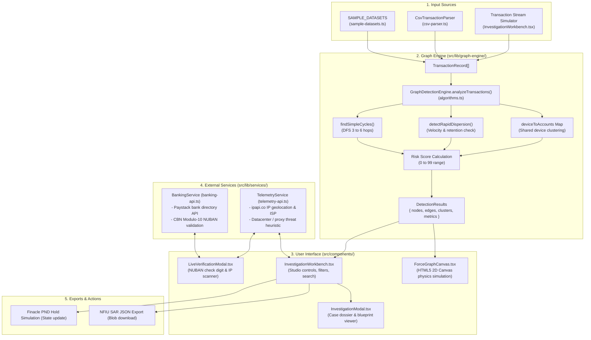

# FININT — Financial Criminal Intelligence Network

A client-side TypeScript and React web application for in-memory graph analytics, money-mule detection, and interactive transaction network visualization.

---

## What This Codebase Does

This repository contains the source code for **FININT** (`finint-platform`), a single-page application built with **React 18**, **TypeScript 5.7**, **Vite 6**, and **Tailwind CSS**.

The application analyzes financial transaction streams client-side in the browser:
1. Ingests raw transaction logs (from built-in datasets including a 2,500-tx Lagos Clearing benchmark, live stream simulation, or user-uploaded CSV files).
2. Converts transactions into a heterogeneous directed bipartite property multigraph of accounts, physical devices, BVNs, and financial flows.
3. Runs Tarjan's Strongly Connected Components (SCC) in O(V + E) linear time to detect circular layering loops, inflow-correlated dispersion analysis, and device multiplexing clustering.
4. Leverages a Grounded GenAI Forensic Copilot that translates topological metrics into CBN AML/CFT 2022 compliant case dossiers with deterministic clickable citations.
5. Renders the resulting network in real time with distinct hardware stars, BVN links, and live PND freeze states on an HTML5 Canvas viewport.
6. Connects to the public Paystack directory for Nigerian bank lookups and computes Central Bank of Nigeria (CBN) Modulo-10 NUBAN check digits locally.
7. Executes state-mutating core banking Post-No-Debit (PND) holds with inspectable Finacle API payloads, and exports official United Nations goAML XML regulatory filings.

---

## Codebase Architecture & Data Flow



---

## Directory Structure

```
zenith/
├── index.html                               # HTML entry point
├── package.json                             # Dependencies, scripts, and project metadata
├── postcss.config.js                        # PostCSS configuration for Tailwind
├── tailwind.config.js                       # Tailwind CSS color tokens and utilities
├── tsconfig.json                            # TypeScript compiler settings
├── tsconfig.app.json                        # App-specific TS configuration
├── tsconfig.node.json                       # Node/Vite TS configuration
├── vite.config.ts                           # Vite configuration with path aliases (@/)
│
└── src/
    ├── main.tsx                             # React DOM entry point
    ├── App.tsx                              # Top-level layout mounting sections & modal state
    ├── index.css                            # CSS tokens, theme variables, and Inter typography
    ├── types.ts                             # Presentation types (GraphNode, FraudTypology, etc.)
    │
    ├── lib/
    │   ├── utils.ts                         # cn() utility for Tailwind class merging
    │   │
    │   ├── graph-engine/
    │   │   ├── types.ts                     # Engine types (TransactionRecord, EntityNode, etc.)
    │   │   ├── algorithms.ts                # GraphDetectionEngine (DFS, smurfing, risk scoring)
    │   │   ├── sample-datasets.ts           # 4 built-in realistic transaction datasets
    │   │   └── csv-parser.ts                # CsvTransactionParser and sample CSV generator
    │   │
    │   └── services/
    │       ├── banking-api.ts               # Paystack bank list & CBN Modulo-10 algorithm
    │       └── telemetry-api.ts             # ipapi.co client & datacenter threat heuristic
    │
    └── components/
        ├── Navbar.tsx                       # Header with navigation anchors & modal triggers
        ├── HeroSection.tsx                  # Header banner, metrics overview, and quick CTAs
        ├── HeroArtwork.tsx                  # SVG network visualization background graphic
        ├── ProblemSection.tsx               # Problem breakdown (Money mules, smurfing, fraud stats)
        ├── FinintShiftSection.tsx           # Comparison table (Traditional TMS vs. FININT)
        ├── FlagshipCapabilitySection.tsx    # Detailed visual breakdown of the graph engine
        ├── ProductPreviewSection.tsx        # High-level preview cards for canvas & cases
        ├── CoreCapabilitiesSection.tsx      # 4 core capability cards
        ├── DifferentiationSection.tsx       # Differentiation pillars against rules-based systems
        ├── FinalCtaSection.tsx              # Bottom CTA with action triggers
        ├── Footer.tsx                       # Footer with regulatory & copyright notices
        ├── InvestigationModal.tsx           # Multi-tab modal (Dossier, Execution Flow, Blueprint)
        │
        ├── graph/
        │   └── ForceGraphCanvas.tsx         # 60 FPS HTML5 Canvas physics renderer
        │
        ├── workbench/
        │   ├── InvestigationWorkbench.tsx   # Live forensic intelligence workbench
        │   └── LiveVerificationModal.tsx    # NUBAN check digit calculator & IP telemetry scanner
        │
        └── ui/                              # UI primitives (Button, Badge, etc.)
            ├── badge.tsx
            └── button.tsx
```

---

## Core Data Models (`src/lib/graph-engine/types.ts`)

The graph engine operates on four core TypeScript contracts:

```typescript
export interface TransactionRecord {
  id: string;
  timestamp: string;      // ISO 8601 string
  sourceId: string;       // Originating account number
  sourceName?: string;    // Account holder name
  targetId: string;       // Receiving account number
  targetName?: string;    // Recipient name
  amount: number;         // Amount in Naira (NGN)
  rail: PaymentRail;      // 'NIP' | 'POS' | 'ATM' | 'MOBILE' | 'WEB' | 'INTERNAL'
  deviceId?: string;      // Mobile UUID / hardware IMEI
  bvn?: string;           // Bank Verification Number
  bankName?: string;      // Bank label
  merchantType?: string;  // Merchant category
  narration?: string;     // Transaction description
}

export interface EntityNode {
  id: string;
  label: string;
  type: 'account' | 'device' | 'bvn' | 'beneficiary' | 'merchant';
  riskScore: number;      // Calculated 8 to 99
  metrics: {
    totalInflow: number;
    totalOutflow: number;
    inDegree: number;
    outDegree: number;
    netRetentionRatio: number; // (Inflow - Outflow) / Inflow
    connectedDeviceIds: string[];
    associatedBvns: string[];
    isInCycle: boolean;
    cycleLength?: number;
    clusterId?: string;
  };
  x: number;              // Canvas X coordinate
  y: number;              // Canvas Y coordinate
  vx: number;             // Physics velocity X
  vy: number;             // Physics velocity Y
  isPinned?: boolean;     // Drag-and-pin state
}

export interface EntityEdge {
  id: string;
  source: string;
  target: string;
  amount: number;
  rail: PaymentRail;
  timestamp: string;
  isHighRisk?: boolean;
  typology?: 'circular' | 'dispersion' | 'fan_out' | 'device_link';
}

export interface SyndicateCluster {
  id: string;
  code: string;           // 'TYP-01', 'TYP-03', 'TYP-04'
  name: string;
  typology: 'circular' | 'dispersion' | 'fan_out' | 'shared_device';
  riskScore: number;
  nodeIds: string[];
  edgeIds: string[];
  totalExposure: number;
  cycleLength?: number;
  timeVelocityMinutes?: number;
  sharedHardware?: string[];
  narrative: string;
  indicators: string[];
  recommendedAction: string;
}
```

---

## Algorithmic Implementation (`src/lib/graph-engine/algorithms.ts`)

The `GraphDetectionEngine.analyzeTransactions()` method processes an array of `TransactionRecord` items synchronously using deterministic algorithms:

### 1. Multi-Hop Cycle Detection (`findSimpleCycles`)
- Constructs an adjacency list from directed transactions (`sourceId -> targetId`).
- Runs a recursive Depth-First Search (DFS) with backtracking.
- Traverses paths between `minLen: 3` and `maxLen: 6`.
- Checks if a path returns to `startNode`, indicating a closed loop ($A \to B \to C \to A$).
- Marks cycle nodes with `metrics.isInCycle = true` and flags participating edges as `typology: 'circular'`.
- Assembles a `TYP-03 Circular Layering Cycle` cluster with an automatically generated narrative:
  ```typescript
  "FININT detected a coordinated closed-loop cyclic fund movement spanning N accounts (ACC-1 → ACC-2 → ...). Total observed transshipment volume is ₦X. Capital was rapidly forwarded with negligible overnight balance retention..."
  ```

### 2. Rapid Dispersion Smurfing (`detectRapidDispersion`)
- Evaluates nodes where `outDegree >= 3` and `netRetentionRatio < 0.15` (retains less than 15% of inbound capital).
- Checks outbound transactions from that node: computes the timestamp delta between the earliest and latest transfer.
- If $\Delta t \le 25\text{ minutes}$, the node is flagged as a `TYP-01 Rapid Dispersion Hub` with `indicators` noting rapid fund splintering.

### 3. Shared Device Clustering (`deviceToAccounts`)
- Builds an inverted index mapping each `deviceId` to the list of accounts that authenticated through it.
- If a device controls $\ge 2$ distinct account profiles, a `TYP-04 Device Multiplex Ring` cluster is created.
- High-risk hardware sharing is flagged with an operational recommendation to blacklist the hardware token.

### 4. Dynamic Risk Scoring Formula
Risk scores are calculated for each node using explicit, deterministic arithmetic:
```typescript
let score = 15; // baseline

if (node.metrics.isInCycle) {
  score += 40;
}
if (node.metrics.connectedDeviceIds.length > 0) {
  const sharedCount = deviceToAccounts.get(node.metrics.connectedDeviceIds[0])?.length || 1;
  if (sharedCount >= 2) score += 30;
}
if (node.metrics.totalInflow > 1_000_000 && node.metrics.netRetentionRatio < 0.15) {
  score += 20; // high-velocity pass-through
}
if (node.metrics.outDegree >= 4) {
  score += 10;
}

node.riskScore = Math.min(99, Math.max(8, score));
```

---

## Live Services (`src/lib/services/`)

### 1. Banking Service (`src/lib/services/banking-api.ts`)
- **`fetchNigerianBanks()`**: Calls `https://api.paystack.co/bank?country=nigeria&perPage=50` via public `fetch()`. Returns active banks with **Zenith Bank Plc (`057`)** sorted to the top. If the network request fails, falls back gracefully to a hardcoded `POPULAR_NIGERIAN_BANKS` list.
- **`validateCbnNubanChecksum(accountNumber, bankCode)`**: Implements the official Central Bank of Nigeria Modulo-10 check digit verification:
  ```typescript
  const weights = [3, 7, 3, 3, 7, 3, 3, 7, 3, 3, 7, 3];
  const combined = bankCode.padStart(3, '0') + accountNumber.substring(0, 9);
  let sum = 0;
  for (let i = 0; i < 12; i++) {
    sum += parseInt(combined[i], 10) * weights[i];
  }
  const calculatedCheckDigit = (10 - (sum % 10)) % 10;
  const providedCheckDigit = parseInt(accountNumber[9], 10);
  const isValid = calculatedCheckDigit === providedCheckDigit;
  ```
- **`resolveAccountWithPaystack(accountNumber, bankCode, secretKey)`**: Optional helper that calls `https://api.paystack.co/bank/resolve?account_number=...&bank_code=...` with an `Authorization: Bearer <secretKey>` header.

### 2. Telemetry Service (`src/lib/services/telemetry-api.ts`)
- **`fetchIpTelemetry(targetIp)`**: Queries `https://ipapi.co/{targetIp}/json/` (or `https://ipapi.co/json/` if no IP is specified).
- Extracts `ip`, `city`, `region`, `country_name`, `latitude`, `longitude`, `isp`, `org`, and `asn`.
- **Heuristic Threat Detection**: Scans the `org` and `isp` strings for datacenter keywords (`hosting`, `datacenter`, `server`, `digitalocean`, `ovh`, `linode`, `aws`, `tor`, `vpn`). If matched, sets `isVpnOrProxy = true` and `threatScore = 94`. If the IP originates outside Nigeria (`country_code !== 'NG'`), sets `threatScore = 68`. Baseline residential connections default to `threatScore = 12`.
- Falls back to cached Nigerian mobile network telemetry (`102.89.43.12` / MTN Nigeria) if the public gateway is unreachable or rate-limited.

---

## Physics Visualizer (`src/components/graph/ForceGraphCanvas.tsx`)

Rendered on an HTML5 `<canvas>` using a custom `requestAnimationFrame` loop:

1. **Coulomb Repulsion**: Pushes all node pairs apart:
   $$F_x = -\frac{k_e \cdot dx}{dist^2}, \quad F_y = -\frac{k_e \cdot dy}{dist^2} \quad (k_e = 4500)$$
2. **Hooke Spring Attraction**: Pulls connected transaction endpoints together:
   $$F_x = dx \cdot k_s, \quad F_y = dy \cdot k_s \quad (k_s = 0.045)$$
3. **Velocity Damping**: Multiplies velocities by $0.85$ each frame to settle oscillations.
4. **Animated Particles**: Renders flowing orange/amber glowing dots along transaction vectors:
   ```typescript
   particleOffsetRef.current = (particleOffsetRef.current + 0.008) % 1;
   ```
5. **High-DPI Scaling**: Uses `window.devicePixelRatio` to prevent canvas blur on Retina displays.
6. **Interaction**: Supports mouse drag-and-pin, mouse-wheel zooming centered at the cursor, and hover hit detection for node inspection cards.

---

## Built-In Datasets & CSV Parser

### Sample Scenarios (`src/lib/graph-engine/sample-datasets.ts`)
1. **`apex-syndicate` (Apex Circular Syndicate)**: 5 nodes, ₦14,250,000 turnover. Forms a 4-hop circular loop (`ACC-4891 -> ACC-8204 -> ACC-9102 -> ACC-7330 -> ACC-4891`) authenticated via iPhone 15 Pro (`DEV-IOS-22`).
2. **`alaba-dispersion` (Alaba POS Smurfing & Dispersion)**: 10 nodes, ₦28,500,000 turnover. A corporate compromise into `ACC-6101` partitioned into 8 Z-Money POS terminals within 14 minutes.
3. **`campus-mules` (Campus Student Mule Ring)**: 8 nodes, ₦4,800,000 turnover. 7 undergraduate accounts controlled by a single Xiaomi device (`DEV-ANDR-XIAOMI`).
4. **`clean-commercial` (Verified Commercial Baseline)**: 4 nodes, ₦115,000,000 turnover. Normal linear B2B supplier transactions with zero cycles and zero alerts.

### Custom CSV Format (`src/lib/graph-engine/csv-parser.ts`)
The `CsvTransactionParser.parseCsv()` method accepts CSV text with the following columns:

```csv
source_account,target_account,amount,payment_rail,device_id,bvn,narration
ACC-001,ACC-002,4500000,NIP,DEV-01,BVN-11223344,Mule transfer 1
ACC-002,ACC-003,4200000,NIP,DEV-01,BVN-11223344,Mule transfer 2
ACC-003,ACC-001,3900000,NIP,DEV-01,BVN-11223344,Circular return
```

- **Required columns**: `source_account` (or `source`/`sender`), `target_account` (or `target`/`receiver`), `amount` (or `value`).
- **Optional columns**: `payment_rail` (NIP, POS, ATM, MOBILE, WEB, INTERNAL), `device_id`, `bvn`, `narration`.
- A downloadable template can be generated via `CsvTransactionParser.generateSampleCsv()`.

---

## Local Development & Setup

### Prerequisites
- **Node.js**: `v18.0.0` or higher
- **npm**: `v9.0.0` or higher

### Installation & Running

```bash
# 1. Clone the repository
git clone https://github.com/your-username/zenith.git
cd zenith

# 2. Install dependencies
npm install

# 3. Start local Vite development server
npm run dev
```

Open `http://localhost:5173` in your browser.

### Building for Production

```bash
# Type-check with tsc and bundle with Vite
npm run build

# Preview the production build locally
npm run preview
```

### Environment Variables (Optional)
The application works completely out of the box with public endpoints. If you want to test live Paystack NIBSS name resolution in the verification modal, create a `.env` file:

```env
VITE_PAYSTACK_SECRET_KEY=sk_test_xxxxxxxxxxxxxxxxxxxx
```

---

## Dependencies (`package.json`)

```json
{
  "dependencies": {
    "clsx": "^2.1.1",
    "lucide-react": "^0.468.0",
    "react": "^18.3.1",
    "react-dom": "^18.3.1",
    "tailwind-merge": "^2.5.5"
  },
  "devDependencies": {
    "@types/react": "^18.3.18",
    "@types/react-dom": "^18.3.5",
    "@vitejs/plugin-react": "^4.3.4",
    "autoprefixer": "^10.4.20",
    "postcss": "^8.4.49",
    "tailwindcss": "^3.4.17",
    "typescript": "^5.7.2",
    "vite": "^6.0.7"
  }
}
```

---

## License

This project is licensed under the [MIT License](LICENSE).
