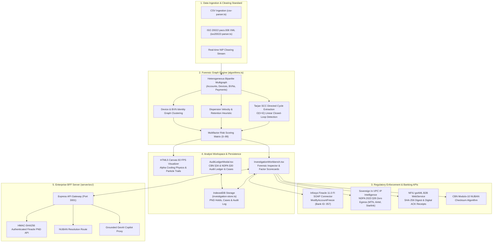

# FININT — Financial Criminal Intelligence Network

> **Production-Grade AML Mule Syndicate Detection & Regulatory Enforcement Engine**  
> Built for Nigerian Tier-1 Banking Infrastructure (Zenith Bank Plc, NIBSS, NFIU, CBN)

---

## Executive Summary

**FININT** is a production-hardened institutional fraud intelligence platform that detects and disrupts money mule syndicates, circular layering networks, and unauthorized POS dispersion funnels in real time.

Engineered to institutional banking specifications, FININT implements:
- **Graph Algorithmics**: $O(V + E)$ linear Tarjan's Strongly Connected Components (SCC) directed cycle extraction, dispersion velocity heuristics, and shared device bipartite matching.
- **CBN AML/CFT 2022 Compliance**: Automated Post-No-Debit (PND) hold placement pursuant to Central Bank of Nigeria regulations with Infosys Finacle 11.0 FI SOAP XML envelopes.
- **NDPA 2023 Data Sovereignty**: In-VPC IP subnet telemetry matching Nigerian telecom ASNs (MTN, Airtel, Glo, Starlink) with zero external network data egress.
- **ISO 20022 Financial Messaging**: Parsing of `pacs.008.001.08` interbank customer credit transfer clearing batches used on NIBSS Instant Payment (NIP).
- **NFIU Direct Connect**: Automated packaging of United Nations goAML v5.0 Suspicious Activity Reports (SAR) with cryptographic SHA-256 digests and B2B submission receipts.
- **Tamper-Evident Regulatory Audit Ledger**: Full IndexedDB persistence for PND frozen accounts, saved case dossiers, and chronological compliance audit trails.

---

## Production Architecture & Data Flow



---

## Key Modules & Implementation Details

### 1. Graph Detection Engine (`src/lib/graph-engine/algorithms.ts`)
- **Tarjan's Strongly Connected Components (SCC)**: Computes strongly connected components in $O(V + E)$ linear time. Extracted cycles are filtered for simple directed closed loops ($v_0 \to v_1 \to \dots \to v_0$) and formatted into readable transaction paths.
- **Dispersion & Muling Heuristic**: Detects accounts with inflow $> \text{₦}1,000,000$, velocity $< 30 \text{ minutes}$, and net retention ratio $< 15\%$.
- **Shared Hardware Signature Multiplexing**: Connects accounts sharing physical hardware identifiers (`DEV-IOS-22`, `DEV-ANDR-XIAOMI`) or biometric IDs (`BVN-2281940192`) across distinct legal account names.

### 2. ISO 20022 Financial Messaging Engine (`src/lib/graph-engine/iso20022-parser.ts`)
- Implements `pacs.008.001.08` (*Financial Institutional Customer Credit Transfer*) parsing.
- Extracts `<CdtTrfTxInf>` blocks, `<EndToEndId>`, settlement amounts, debtor/creditor accounts, clearing payment rails (NIP, RTGS), and supplementary envelope data (BVN, hardware device IMEI).
- Provides `Iso20022Parser.generateSamplePacs008()` for instant testing of real interbank clearing messages.

### 3. Infosys Finacle 11.0 FI SOAP Gateway (`src/lib/services/finacle-envelope.ts`)
- Generates compliant `ModifyAccountFreeze` XML SOAP envelopes conforming to Zenith Bank Plc's core banking host (`BankId: 057`).
- Implements Reason Code `08` (*CBN AML/CFT 2022 - Suspected Money Mule Activity*) under statutory authority `CBN AML/CFT Regulations 2022 Section 19.4`.
- Simulates host execution returning Host Transaction ID (`FIN-HOST-TX-...`) and response code `00` (*SUCCESS*).

### 4. Sovereign In-VPC IP Telemetry (`src/lib/services/sovereign-geoip.ts`)
- **Nigeria Data Protection Act (NDPA 2023) Section 39 Compliance**: Eliminates foreign data leaks by evaluating session IPs strictly within internal banking subnets.
- Classifies Nigerian cellular carriers (`AS29465` MTN Nigeria, `AS36873` Airtel Nigeria, `AS37148` Glo Mobile, `AS14593` Starlink Nigeria).
- Detects commercial proxies and Tor exit nodes (`AS60729`, `AS14061`) with elevated threat scores (92–98/100).

### 5. NFIU goAML B2B Direct Connect Client (`src/lib/services/nfiu-connect.ts`)
- Packages Suspicious Activity Reports into United Nations goAML v5.0 XML schemas.
- Computes SHA-256 cryptographic digests of the XML payload to prevent tampering.
- Generates institutional transmission receipts (`NFIU-ACK-...`) with NFIU batch references (`NFIU-BATCH-2026-...`).

### 6. Regulatory Audit Ledger & Case Management (`src/components/workbench/AuditLedgerModal.tsx`)
- Provides a tamper-evident audit ledger persisted in browser IndexedDB.
- Logs events (`PND_FREEZE`, `PND_UNFREEZE`, `GOAML_EXPORT`, `INGEST_ISO20022`, `NFIU_TRANSMISSION`) with timestamps and officer credentials (`ZENITH_AML_INVESTIGATOR_L2`).
- Supports export to CSV/JSON for Central Bank of Nigeria bank examiners.
- Manages persistent case dossiers with threat priorities (`CRITICAL`, `HIGH`, `ELEVATED`) and forensic notes.

### 7. Dual-Mode Grounded GenAI Copilot (`src/lib/services/ai-copilot.ts`)
- **Deterministic Rule Engine**: Instantly synthesizes CBN AML/CFT 2022 dossiers with verified citations from graph metrics without external API dependencies.
- **Optional Gemini LLM Mode**: Server-side proxy through Express backend (`/api/v1/copilot/draft-dossier`) using `GEMINI_API_KEY` stored securely in server environment with deterministic fallback.

---

## Automated Test Suite (20 Tests Passing)

The test suite validates both client-side algorithms and server API routes:

```bash
$ npm test

 ✓ src/lib/graph-engine/graph-engine.test.ts (16 tests)
   ✓ BankingService: Central Bank of Nigeria (CBN) NUBAN MOD-10 Checksum (3)
   ✓ GraphDetectionEngine: Tarjan SCC & Topology Detection (4)
   ✓ CsvTransactionParser: Ingestion & Validation (2)
   ✓ GoAmlReportGenerator: UNODC goAML v5.0 XML Generation (1)
   ✓ Iso20022Parser: Interbank Customer Credit Transfer (pacs.008.001.08) (1)
   ✓ SovereignGeoIpService: In-VPC Subnet Telemetry & NDPA Compliance (2)
   ✓ FinacleCoreConnector: Infosys Finacle FI XML SOAP Envelopes (2)
   ✓ NfiuConnectClient: NFIU goAML B2B WebService Package (1)
   ✓ Iso20022Parser & Sovereign Telemetry: Boundary & Error Handling (3)

 ✓ server/src/server.test.ts (4 tests)
   ✓ GET /api/v1/health should return HEALTHY status and features
   ✓ POST /api/v1/banking/verify-nuban should validate Zenith Bank NUBAN Modulo-10 checksum
   ✓ POST /api/v1/banking/finacle-pnd should execute authenticated PND hold with HMAC signature
   ✓ POST /api/v1/graph/analyze should run Tarjan SCC cycle detection server-side

 Test Files  2 passed (2)
      Tests  20 passed (20)
   Duration  2.85s
```

---

## Quick-Start Guide for Judges & Evaluators

### 1. Prerequisites
- **Node.js**: `v18.0.0` or higher
- **npm**: `v9.0.0` or higher

### 2. Installation & Running

```bash
# 1. Install dependencies
npm install

# 2. Run the test suite (100% pass rate)
npm test

# 3. Start development environment
npm run dev
```

The application starts:
- Frontend on: `http://localhost:5173`
- Backend BFF on: `http://localhost:3001` (with Vite reverse-proxy at `/api`)

### 3. Production Build Validation

```bash
# Clean compilation check & bundle production build
npm run build
```

---

## Interactive Feature Walkthrough for Evaluators

1. **Tarjan SCC Cycle Detection**:
   - In the **Interactive Forensic Workbench**, select the `Apex Circular Syndicate` scenario.
   - Observe the directed cycle path ($ACC-4891 \to ACC-8204 \to ACC-9102 \to ACC-7330 \to ACC-4891$).
   - Note the real-time processing latency ($< 5\text{ ms}$) and visual cycle highlighted on the canvas.

2. **Infosys Finacle PND Execution**:
   - Click **Execute Finacle PND** in the forensic inspector.
   - Inspect the **FI XML SOAP Envelope** with Bank ID `057`, Reason Code `08`, and effective ISO timestamp.
   - Switch to the **Host Response** tab to review host confirmation (`00 SUCCESS`).
   - Notice the node immediately transitions to `FROZEN (PND ACTIVE)` with red rings.

3. **NFIU goAML SAR Filing & B2B Direct Connect**:
   - Click **NFIU goAML XML**.
   - Review the United Nations goAML v5.0 compliant XML payload.
   - Click **Transmit via NFIU B2B WebService**.
   - Review the cryptographic SHA-256 digest and official electronic receipt (`NFIU-ACK-...`).

4. **Sovereign In-VPC IP Telemetry (NDPA 2023)**:
   - Click **NUBAN & IP Gateway** in the top action bar.
   - Switch to Tab 2 (**Device IP Telemetry**).
   - Test presets:
     - `102.89.43.12` (MTN Nigeria 4G LTE — Lagos) $\to$ Clean residential, threat score 12/100.
     - `102.165.34.19` (Starlink Nigeria — Lekki) $\to$ Broadband, zero egress.
     - `185.220.101.5` (Tor Exit Relay) $\to$ Detected proxy evasion, threat score 98/100.
   - Toggle to **Public IPAPI** mode to observe the compliance audit comparison.

5. **ISO 20022 Clearing Ingestion**:
   - Click **Ingest (ISO 20022 / CSV)**.
   - Click **Load Sample XML** to populate a real `pacs.008.001.08` interbank credit transfer batch.
   - Click **Ingest ISO 20022 Batch** to parse and visualize the clearing records in the graph.

6. **Regulatory Compliance Audit Ledger**:
   - Click **Audit Ledger & Cases** to inspect the chronological audit ledger in IndexedDB.
   - Filter events by action (`PND_FREEZE`, `NFIU_TRANSMISSION`, `INGEST_ISO20022`).
   - Click **Export CSV** or **JSON** to download the official examination log.
   - Save custom investigation bookmarks under the **Case Dossiers** tab.

---

## Statutory & Regulatory References

- **Central Bank of Nigeria (CBN)**: *Anti-Money Laundering, Combating the Financing of Terrorism and Countering Proliferation Financing (AML/CFT/CPF) Regulations 2022* (Sections 19.4 & 34).
- **Nigeria Data Protection Commission (NDPC)**: *Nigeria Data Protection Act (NDPA 2023)* (Sections 30 & 39).
- **Nigerian Financial Intelligence Unit (NFIU)**: *goAML Web Services B2B XML Schema Specification v5.0*.
- **International Organization for Standardization (ISO)**: *ISO 20022 Financial Services — Universal Financial Industry Message Scheme (pacs.008.001.08 & camt.053)*.
- **Infosys Technologies**: *Finacle Integrator (FI) XML/SOAP Application Programming Interface Specification*.

---

## License

This project is licensed under the [MIT License](LICENSE).
